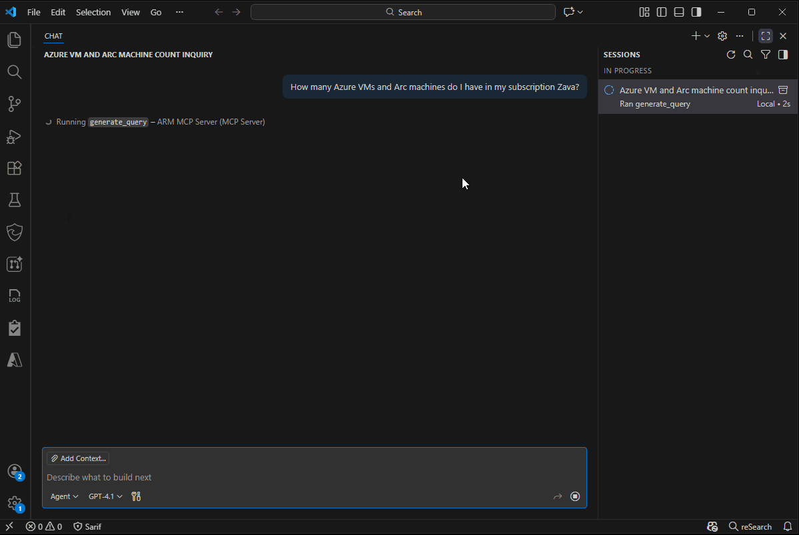

# Azure Resource Manager MCP server

This is a repository to track features, bugs, and suggestions for the Azure Resource Manager MCP server.

## Overview
Azure Resource Manager (ARM) is the control plane of Azure. Every operation that creates, updates,
or deletes Azure resources flows through ARM, regardless of whether it comes from the Azure portal,
CLI, PowerShell, REST APIs, or SDKs.

AI agents introduce a new kind of Azure client that needs a consistent, centralized way to interact
with ARM. The **Azure Resource Manager MCP server** is designed to provide that access layer through the Model
Context Protocol (MCP), the standard protocol agents use to perform actions and retrieve dynamic
data.

Today, the **Azure Resource Manager MCP server** equips agents with tools to query Azure resources,
deploy and manage ARM templates, create or update resources, inspect resource type schemas, and
analyze Azure costs and pricing. Its core purpose is to enable AI agents to interact with Azure
resources seamlessly, just like other ARM clients. More capabilities will be added in the future.

## Features
The Azure Resource Manager MCP server supports Azure management workflows including:
- Resource discovery with Azure Resource Graph
- ARM template preview and deployment
- Resource create/update operations
- Resource type and schema discovery
- Cost and pricing analysis

For the authoritative, up-to-date tool catalog and feature behavior, use Microsoft Learn:
- [ARM MCP server overview](https://learn.microsoft.com/azure/azure-resource-manager/management/azure-resource-manager-mcp-overview)
- [ARM MCP server tools](https://learn.microsoft.com/azure/azure-resource-manager/management/azure-resource-manager-mcp-tools)
- [Secure and govern ARM MCP server use](https://learn.microsoft.com/azure/azure-resource-manager/management/azure-resource-manager-mcp-governance)

## Supported Clients
During this preview, Azure Resource Manager MCP server can only be used with a set of MCP Clients. Right now you can use:
- **GitHub Copilot Chat** in VS Code.
- **GitHub Copilot CLI**

Support for additional clients will be added based on user feedback and demand. If you have a
specific client you'd like to see supported, please open an issue to let us know!

### Other client support

For 3rd-party client setup details (app registration, manifest permissions, redirect URI, service principal
creation, and connector configuration), see [Configure an MCP client for the ARM MCP server](https://learn.microsoft.com/azure/azure-resource-manager/management/azure-resource-manager-mcp-other-clients).

## Getting Started

### Prerequisites
- VS Code installed 
- Valid Azure Account
- GitHub Copilot account 

### Installation

#### 1. Installing the MCP Server
1. Open: **https://aka.ms/JoinARMMCP**. VS Code will launch automatically. 

2. When prompted inside VS Code, click **Install** under **Azure Resource Manager MCP server** to add it to your MCP server configuration.

3. You will be prompted to sign in with your Azure credentials. 

#### 2. Open the Chat Interface
1. In VS Code, go to **View > Chat**, or click the chat icon to the right of the center toolbar
   header.
2. In the Chat window, click the **Configure Tools** icon.  
3. Ensure **Azure Resource Manager MCP server** is checked.
4. For the current tool list and guidance, see [ARM MCP server tools](https://learn.microsoft.com/azure/azure-resource-manager/management/azure-resource-manager-mcp-tools).

## Usage

1. Open the Chat interface in VS Code.
2. Ensure the Azure Resource Manager MCP server tools are enabled.
3. Type your query or request in natural language.

### Demo using the ARG tools

### Demo using the Deployment tools

## Troubleshooting & FAQ

See [What is the Azure Resource Manager MCP server?](https://learn.microsoft.com/azure/azure-resource-manager/management/azure-resource-manager-mcp-overview)
for canonical documentation and links to setup, tools, and governance guidance.

## Governance

The Azure Resource Manager MCP server uses the same authentication and authorization context as the
signed-in user in VS Code. This means that all tool calls are made on behalf of that user and are
subject to the same permissions and access controls defined in Azure.

### Blocking Template requests
To prevent any deployments from being made via the ARM MCP server you can apply an Azure Policy to
the relevant scope (subscription or resource group) that denies requests made by the deployment tool
(`create_deployment`). To see an example of such a policy, please refer to [this sample
policy](./docs/BlockingDeploymentsPolicy.json). You will need to specifically block the AppID of the
MCP server, which is `22bfbae3-f4e7-485f-be43-8cee15065084`.

## Contributing

This repository is dedicated solely to gathering feedback from users and contributors. While
contributions aimed at clarifying wording or improving documentation details are welcome, the
primary purpose of this repository is to facilitate feedback through the creation of issues. Please
use issues to share your thoughts, suggestions, or concerns, as this helps us better understand and
address your problems!

## Code of Conduct

This project has adopted the [Microsoft Open Source Code of
Conduct](https://opensource.microsoft.com/codeofconduct/). For more information, see the
[CODE_OF_CONDUCT.md](./CODE_OF_CONDUCT.md) file.

## Transparency FAQ

For more information about how the Azure Resource Manager MCP server AI capabilities works, its
limitations, and best practices for use, please refer to our [Transparency
FAQ](./ResponsibleAITransparencyFAQ.md).

## License
This project is licensed under the MIT License. See [LICENSE](LICENSE) for details.

## Data Collection
The Azure Resource Manager MCP server does not collect any personally identifiable information. We collect
minimal operational telemetry to capture amount of times a tool is called and service uptime. Our
privacy statement is located at https://go.microsoft.com/fwlink/?LinkID=824704.

## Trademarks

This project may contain trademarks or logos for projects, products, or services. Authorized use of
Microsoft trademarks or logos is subject to and must follow [Microsoft’s Trademark & Brand
Guidelines](https://www.microsoft.com/en-us/legal/intellectualproperty/trademarks/usage/general). Use of Microsoft trademarks or logos in modified versions of this project must not cause
confusion or imply Microsoft sponsorship. Any use of third-party trademarks or logos are subject to
those third-party’s policies.
